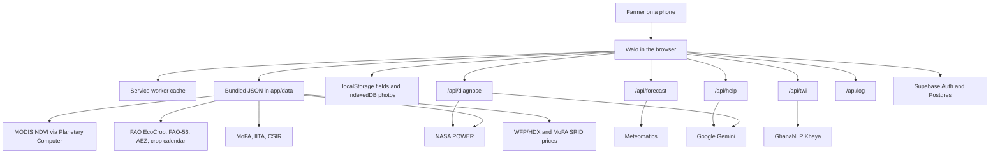
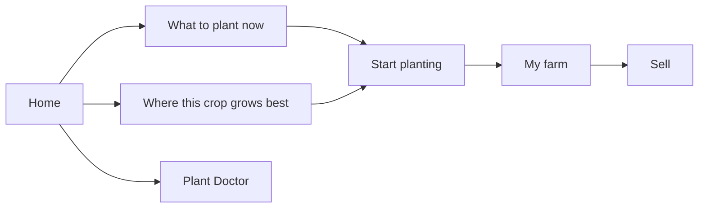

# Walo

**Walo** (Ga for “helper”) is a mobile web app for low-literacy smallholder farmers in Ghana. A farmer picks a place and sees what to plant now, or picks a crop and sees where it grows best. The same app follows a field from sowing to sale, and can look at a sick plant.

Kenya can be used as a **preview**: `countries.json` holds it as `preview`, with 14 county towns, NASA POWER climate for each, MODIS greenness, its own outline map, per-kilogram prices for six crops from HDX HAPI, and planting windows for maize, sorghum, millet, cowpea, cassava and sweet potato taken from the FEWS NET Kenya seasonal calendar and the Ministry of Agriculture cropping calendar in the Kenya Food Security Data Book 2025. The country picker says plainly that nobody farming there has checked those windows yet; `checked_by_local` stays false until someone has, which is what turns it `live`. Ghana's long-run price index is not extended to Kenya: HAPI carries about a year of Kenyan prices, not enough for a seasonal pattern.

Team **Simply Zero**. [NASA Space Apps Challenge 2026](https://www.spaceappschallenge.org/), challenge **Field Shift: Adapting Farms with NASA Data**, Kumasi local event.

**Challenge:** Field Shift: Adapting Farms with NASA Data. Walo is a decision-support tool for planting and rotation: NASA Earth observations set the rain, heat and soil-water terms, and local soil and crop calendars set the rest.

**NASA data that makes the project eligible:** NASA POWER daily (AG community, 1991–2025) is the primary source, and the one to tick in the challenge's Resources list on the submission form; NASA MODIS/Terra MOD13Q1 NDVI is the second. Nothing else decides a number NASA data can answer: the Meteomatics forecast only times the next ten days, and Copernicus DEM stands in for SRTM, which needs an Earthdata login.

**AI disclosure, in one line:** the idea, the crops, the rules and the review are the team's; the app code, the data-build scripts and the redesign were written with an AI assistant (Grok Bot), and Plant Doctor and Get help call Gemini at runtime. No AI-generated images, audio or video, and no NASA branding. Full log: [app/AI_USE.md](app/AI_USE.md).

Walo is a participant project built at the Kumasi local event on 14–15 November 2026. It is not a NASA product, and NASA does not endorse it.

**Live app:** [https://walo-simply-zero.vercel.app](https://walo-simply-zero.vercel.app)

The app is static HTML, CSS, and JavaScript, plus serverless functions in `app/api/`. Vercel’s **Root Directory** for this repository is `app` (see [Deploy](#deploy)).

## Who it is for

A farmer on a shared, low-cost Android phone, often outdoors, who reads a little English and would rather listen. Each answer screen leads with one icon, one plain sentence, and a Listen button. Numbers, methods, and sources sit behind **Why?**. Walo supports a decision. It does not replace the farmer’s judgement.

## Features

| Task | Route | What the farmer gets |
| --- | --- | --- |
| What to plant now | `#/now` | One answer for the chosen place this week, then crops grouped by when they can be planted |
| Where a crop grows best | `#/crop/<crop>` | Plant now, plant in a named month, or wait; a Ghana map of towns where it fits |
| Start planting | `#/start` | Crop, optional field photo, sowing day (today or a past day, or the next window) |
| My farm | `#/farm` | Stage, harvest timing, today’s task, one alert, photos kept on the phone |
| What to plant after this crop | `#/next/<crop>` | Rotation options compared on soil, the NASA rain water balance, heat and price, always including the crop already in the field |
| How this place is changing | `#/shift` | The same NASA POWER record in two halves (1991–2014, 2015–2025): when the rains start, season rain, hot days |
| Sell | `#/sell` | When that field’s harvest usually sells best, and at which nearby market |
| Plant Doctor | `#/doctor` | Photo, voice, or text. An AI names a likely problem and one careful next step |
| Get help | `#/help` | AI answers first (Gemini), in English. Call and WhatsApp stay hidden until `support.phone` is set; it is empty, so the screen says a person is coming soon |
| Offline | top bar | An Offline chip. Anything that needs a network is grey and tagged “Needs internet” |
| Back up my fields | `#/backup` | Optional email one-time code. The app works with no account |

Tabs are **Home**, **My farm**, **Sell**, and **Doctor**. The place chip in the top bar changes the town everywhere that advice depends on place. On a wide screen the app sits in a phone-width column.

The hackathon build is **English only**. Listen uses the phone’s own English voice. `data/app.json` → `languages.enabled` is `["en"]`, which gates every Twi path: no EN/Twi chip, no Twi messages, a saved Twi choice is cleared on load, and `/api/twi` returns 404. The Khaya code and `data/i18n-tw.json` stay in the repo. After the hackathon the plan is a language picker for Twi, Ga, Ewe, Fante, and Dagbani, each shown only when the text is complete and a speaker has reviewed it.

## How it works



Two ways in, then one farm record:



The browser holds the climate summaries, crop rules, and price indexes. It asks the server only for the 10-day forecast, Plant Doctor, Get help, Twi, a tiny diagnostic log, and optional backup. API keys never go to the phone. `app/DESIGN.md` is the design record and the methods chapter.

## Data sources

| Source | Used for | Link |
| --- | --- | --- |
| NASA POWER (AG community, daily, 1991–2025) | Rain, temperature, humidity, wind, sunshine, onset of rains, water balance, heat, growing degree days | [power.larc.nasa.gov](https://power.larc.nasa.gov/) |
| NASA MODIS/Terra MOD13Q1 v6.1 NDVI, via Microsoft Planetary Computer | Town greenness, 2016–2025 and the latest composite | [doi:10.5067/MODIS/MOD13Q1.061](https://doi.org/10.5067/MODIS/MOD13Q1.061) · [Planetary Computer](https://planetarycomputer.microsoft.com/dataset/modis-13Q1-061) |
| FAO EcoCrop | Temperature and rainfall suitability | [OpenCLIM EcoCrop table](https://github.com/OpenCLIM/ecocrop/blob/main/EcoCrop_DB.csv) · method: [Ramirez-Villegas et al. 2013](https://doi.org/10.1016/j.agrformet.2011.09.005) |
| FAO Irrigation and Drainage Paper 56 | Reference evapotranspiration, crop coefficients, stage lengths | [FAO-56](https://www.fao.org/4/x0490e/x0490e00.htm) |
| FAO Agro-ecological Zones and the Ghana crop calendar | Zone, growing period, planting windows | [Crop calendar](https://cropcalendar.apps.fao.org/) · [Ghana AEZ](https://api-cropcalendar.apps.fao.org/api/v1/countries/GH/aez?language=en) |
| FAO land evaluation (1976) and Frère & Popov (1979) | Suitability class names; water requirement satisfaction index | [Soils Bulletin 32](https://www.fao.org/4/x5310e/x5310e00.htm) |
| MoFA production guides | Ghana crop practice per crop | [mofa.gov.gh](https://mofa.gov.gh/) |
| MoFA SRID commodity prices | Market prices per kilogram, retail and wholesale, every two weeks, April–October 2025 in 16 markets (SRID has published no newer public file) | [SRID prices](https://srid.mofa.gov.gh/node/18) · built by `app/scripts/build_srid_prices.py` |
| Ghana Commodity Exchange | Traded closing prices per kilogram for white maize and soya bean at the Tamale, Kumasi and Sandema warehouses, 2026 | [GCX market data](https://www.gcx.com.gh/market-data) · built by `app/scripts/build_gcx_prices.py` |
| HDX HAPI market prices (other countries) | WFP market prices in one schema across countries: market coordinates, currency, the unit the market sells in, retail or wholesale, monthly. Converted to price per kilogram; used for the countries Walo is expanding into, not yet loaded by the app | [HDX HAPI](https://hapi.humdata.org/docs) · built by `app/scripts/build_hapi_prices.py` |
| IITA and CSIR-SARI (and related Ghana trials) | Crop guides for maize, sorghum, cassava, yam, plantain, cowpea, millet | Per-crop list in [docs/walo-crops-sources.md](docs/walo-crops-sources.md) |
| NASA POWER daily, same point, 1991–2014 vs 2015–2025 | How the season has moved at her town: two periods and a 35-year trend (`data/shift.json`, built by `app/scripts/build_shift.py`) | [power.larc.nasa.gov](https://power.larc.nasa.gov/) |
| FAO agro-ecological zones and the district soil notes in `docs/walo-crops-sources.md` | The usual soil for her zone, which the rotation screen starts from (`data/soil.json`) | [FAO crop calendar](https://cropcalendar.apps.fao.org/) |
| Copernicus DEM, 3×3 samples around each town, via Open-Meteo's elevation API | Slope, for the erosion screening behind the rotation advice (`data/soilhealth.json`, built by `app/scripts/build_soilhealth.py`). SRTM was the intended source; it needs an Earthdata login, so the app says which DEM it actually used | [Open-Meteo elevation](https://open-meteo.com/en/docs/elevation-api) |
| NASA MODIS NDVI peak month + NASA POWER rain | Usual ground cover and rain erosivity, combined with slope into a low / medium / high erosion screening per town. A screening to compare towns, not RUSLE and not a soil test | [MODIS MOD13Q1](https://lpdaac.usgs.gov/products/mod13q1v061/) |
| WFP food prices for Ghana, via HDX | Seasonal price index, 20 markets, observations through July 2023 | [HDX dataset](https://data.humdata.org/dataset/wfp-food-prices-for-ghana) |
| Meteomatics Weather API | 10-day rain and maximum temperature. Climatology stays NASA POWER | [Getting started](https://www.meteomatics.com/en/api/getting-started/) |
| Google Gemini | Plant Doctor and Get help, on the server, labelled as AI | [Gemini API](https://ai.google.dev/gemini-api/docs) |
| GhanaNLP Khaya | Twi translation, voice, and speech-to-text, on the server | [ghananlp.org](https://ghananlp.org/) |
| OpenStreetMap Nominatim | Place name for “Use my location” | [Copyright](https://www.openstreetmap.org/copyright) |

Bundled assets and libraries, cited because Space Apps asks for every source, including free and open-source ones:

| Asset | Licence | Where |
| --- | --- | --- |
| 24 crop, field, market and hero photographs | Wikimedia Commons, CC BY-SA 4.0 / 2.0, author and source link per photo | `app/data/credits.json`, and the About screen in the app |
| Plus Jakarta Sans | SIL OFL 1.1 | `app/licenses/PlusJakartaSans-OFL.txt` |
| Lucide icons | ISC | `app/licenses/Lucide-ISC.txt` |
| supabase-js (optional backup) | MIT, included unmodified | `app/licenses/supabase-js-MIT.txt` |
| Natural Earth map outline | Public domain | `app/data/ghana-map.json`, About screen |
| OpenStreetMap Nominatim | ODbL, place name for "Use my location" | About screen and the table above |
| No AI-generated images, audio or video | — | See `app/AI_USE.md` |

Every threshold the app applies is in `app/data/rules.json` with its source, or marked `default: true` when no single standard exists. Per-crop citations are in [docs/walo-crops-sources.md](docs/walo-crops-sources.md).

## Repository layout

```
app/                  Vercel root. The running app.
  index.html          Page shell and the two photo inputs
  styles.css          Design tokens and components
  js/                 Router, data layer, screens
  api/                Serverless functions (diagnose, forecast, help, twi, log)
  data/               JSON the phone reads
  lib/agro.js         FAO-56, onset, EcoCrop, growing degree days
  scripts/            Data builders. Not deployed (app/.vercelignore)
    data/             Their raw inputs and full outputs (prices-world.json and friends), not read by the app
  AI_USE.md           Space Apps AI disclosure
  DESIGN.md           Design record and the methods chapter
supabase/schema.sql   Table, row-level security, photo bucket, and the daily AI budget
docs/                 Per-crop source notes
```

`app/DESIGN.md` is the design history; section 13b is the current app and section 14 is the methods. `app/AI_USE.md` is the challenge disclosure. This README is the front door for a new teammate.

## Run locally

Static screens need only Python 3:

```bash
cd app
python3 -m http.server 8000
```

Open [http://localhost:8000](http://localhost:8000). Planting advice, the map, My farm, and Sell work from the bundled JSON. Forecast, Plant Doctor, Get help, Twi, and backup need the functions in `app/api/`.

From `app/`, with the [Vercel CLI](https://vercel.com/docs/cli) and the names in `.env.example` filled in a local `.env` (that file is gitignored):

```bash
cd app
vercel dev
```

## Deploy

The live Vercel project is **walo-simply-zero**.

1. Connect this GitHub repository to that project.
2. Set **Root Directory** to `app`. `app/vercel.json` sets function duration and memory, and tells the browser not to cache `/api/`. It only works when the project root is `app`.
3. No build command. Vercel serves the static files and turns `app/api/*.js` into serverless functions.
4. Add the environment variable **names** in [Environment variables](#environment-variables). Redeploy after saving them.
5. `app/.vercelignore` excludes `scripts/`, so the builders and their full outputs are not part of the deployment. The phone reads `data/*.json` only.

A deploy from the repository root, with Root Directory left at `.`, will not find `index.html` and will not mount `api/`.

## Environment variables

Set these in Vercel. Names only here. Values stay in the dashboard.

| Name | Function | If it is unset |
| --- | --- | --- |
| `GEMINI_API_KEY` | `api/diagnose.js`, `api/help.js` | Plant Doctor and Get help say they are not set up |
| `METEOMATICS_USER` | `api/forecast.js` | “What to plant now” uses the NASA climatology only |
| `METEOMATICS_PASS` | `api/forecast.js` | Same as above |
| `KHAYA_API_KEY` | `api/twi.js`, only after `"tw"` is added to `languages.enabled`. The route returns 404 while English is the only enabled language | Twi stays off |
| `GEMINI_MODEL` | optional, `api/_gemini.js` | The server picks a current Flash model |

The Supabase project URL and the **publishable** key are in `app/data/app.json` under `backup`. They are meant to be public. Row-level security limits each person to their own rows. Do not add a service-role key anywhere in this repository or in client code.

The hard daily cap on Gemini calls is **not** an environment variable. It is a constant inside `public.walo_ai_hit()` in [supabase/schema.sql](supabase/schema.sql) (400 calls a day by default), because a cap the app sends is a cap an attacker chooses. Apply that file once in the Supabase SQL editor; the file also creates the `fields` table, its four row-level-security policies, and the private `field-photos` bucket with per-owner policies. Until it is applied, the per-IP limits in `api/diagnose.js` and `api/help.js` still run and the app keeps answering.

Project ref: `yceufknddlcrezefaivi`.

## Checks before you push

```bash
python3 -c "import json,pathlib; [json.loads(p.read_text()) for p in pathlib.Path('app').rglob('*.json')]"
find app -name '*.js' -print0 | xargs -0 -n1 node --check
```

## More documentation

- [app/DESIGN.md](app/DESIGN.md) — design record, section 13b current app, section 14 methods
- [docs/walo-crops-sources.md](docs/walo-crops-sources.md) — per-crop sources and confidence
- [app/AI_USE.md](app/AI_USE.md) — what AI wrote, and what it did not

## License

Code is [MIT](LICENSE). Photographs, the font, icons, the bundled Supabase library, and the data files keep the licenses named in `app/data/credits.json` and `app/licenses/`.
