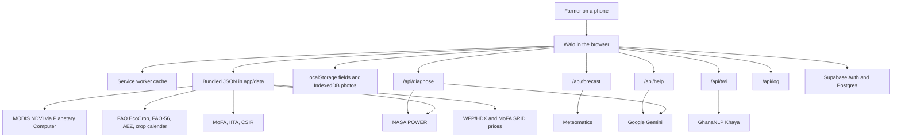
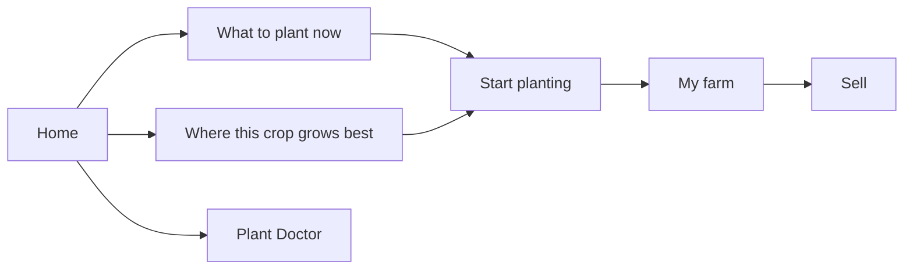

# Walo

**Walo** (Ga for “helper”) is a mobile web app for low-literacy smallholder farmers in Ghana. A farmer picks a place and sees what to plant now, or picks a crop and sees where it grows best. The same app follows a field from sowing to sale, and can look at a sick plant.

Team **Simply Zero**. [NASA Space Apps Challenge 2026](https://www.spaceappschallenge.org/), challenge **Field Shift: Adapting Farms with NASA Data**, Kumasi local event.

**Live app:** [https://walo-simply-zero.vercel.app](https://walo-simply-zero.vercel.app)

The app is static HTML, CSS, and JavaScript, plus serverless functions in `app/api/`. Vercel’s **Root Directory** for this repository is `app` (see [Deploy](#deploy)).

## Who it is for

A farmer on a shared, low-cost Android phone, often outdoors, who reads a little English and would rather listen. Each answer screen leads with one icon, one plain sentence, and a Listen button. Numbers, methods, and sources sit behind **Why?**. Walo supports a decision. It does not replace the farmer’s judgement.

## Features

| Task | Route | What the farmer gets |
| --- | --- | --- |
| What to plant now | `#/now` | One answer for the chosen place this week, then crops grouped by when they can be planted |
| Where a crop grows best | `#/crop/<crop>` | Plant now, plant in a named month, or wait; a Ghana map of towns where it fits |
| Start planting | `#/start` | Crop, optional field photo, sowing day (today or a past day, or the next window) |
| My farm | `#/farm` | Stage, harvest timing, today’s task, one alert, photos kept on the phone |
| Sell | `#/sell` | When that field’s harvest usually sells best, and at which nearby market |
| Plant Doctor | `#/doctor` | Photo, voice, or text. An AI names a likely problem and one careful next step |
| Get help | `#/help` | AI answers first (Gemini), in English. Call and WhatsApp stay hidden until `support.phone` is set; it is empty, so the screen says a person is coming soon |
| Offline | top bar | An Offline chip. Anything that needs a network is grey and tagged “Needs internet” |
| Back up my fields | `#/backup` | Optional email one-time code. The app works with no account |

Tabs are **Home**, **My farm**, **Sell**, and **Doctor**. The place chip in the top bar changes the town everywhere that advice depends on place. On a wide screen the app sits in a phone-width column.

The hackathon build is **English only**. Listen uses the phone’s own English voice. `data/app.json` → `languages.enabled` is `["en"]`, which gates every Twi path: no EN/Twi chip, no Twi messages, a saved Twi choice is cleared on load, and `/api/twi` returns 404. The Khaya code and `data/i18n-tw.json` stay in the repo. After the hackathon the plan is a language picker for Twi, Ga, Ewe, Fante, and Dagbani, each shown only when the text is complete and a speaker has reviewed it. See [docs/HANDOFF.md](docs/HANDOFF.md).

The live deployment of this app is `dpl_CHUzrfUQkVGaUMReutssEamCsPrJ`. The service worker cache is `walo-v25`.

## How it works



Two ways in, then one farm record:



The browser holds the climate summaries, crop rules, and price indexes. It asks the server only for the 10-day forecast, Plant Doctor, Get help, Twi, a tiny diagnostic log, and optional backup. API keys never go to the phone. Details: [docs/ARCHITECTURE.md](docs/ARCHITECTURE.md). Methods: [docs/METHODS.md](docs/METHODS.md).

## Data sources

| Source | Used for | Link |
| --- | --- | --- |
| NASA POWER (AG community, daily, 1991–2025) | Rain, temperature, humidity, wind, sunshine, onset of rains, water balance, heat, growing degree days | [power.larc.nasa.gov](https://power.larc.nasa.gov/) |
| NASA MODIS/Terra MOD13Q1 v6.1 NDVI, via Microsoft Planetary Computer | Town greenness, 2016–2025 and the latest composite | [doi:10.5067/MODIS/MOD13Q1.061](https://doi.org/10.5067/MODIS/MOD13Q1.061) · [Planetary Computer](https://planetarycomputer.microsoft.com/dataset/modis-13Q1-061) |
| FAO EcoCrop | Temperature and rainfall suitability | [OpenCLIM EcoCrop table](https://github.com/OpenCLIM/ecocrop/blob/main/EcoCrop_DB.csv) · method: [Ramirez-Villegas et al. 2013](https://doi.org/10.1016/j.agrformet.2011.09.005) |
| FAO Irrigation and Drainage Paper 56 | Reference evapotranspiration, crop coefficients, stage lengths | [FAO-56](https://www.fao.org/4/x0490e/x0490e00.htm) |
| FAO Agro-ecological Zones and the Ghana crop calendar | Zone, growing period, planting windows | [Crop calendar](https://cropcalendar.apps.fao.org/) · [Ghana AEZ](https://api-cropcalendar.apps.fao.org/api/v1/countries/GH/aez?language=en) |
| FAO land evaluation (1976) and Frère & Popov (1979) | Suitability class names; water requirement satisfaction index | [Soils Bulletin 32](https://www.fao.org/4/x5310e/x5310e00.htm) |
| MoFA production guides and SRID prices | Ghana crop practice; 2025 Techiman prices | [mofa.gov.gh](https://mofa.gov.gh/) · [SRID prices](https://srid.mofa.gov.gh/node/18) |
| IITA and CSIR-SARI (and related Ghana trials) | Crop guides for maize, sorghum, cassava, yam, plantain, cowpea, millet | Per-crop list in [docs/walo-crops-sources.md](docs/walo-crops-sources.md) |
| WFP food prices for Ghana, via HDX | Seasonal price index, 20 markets, observations through July 2023 | [HDX dataset](https://data.humdata.org/dataset/wfp-food-prices-for-ghana) |
| Meteomatics Weather API | 10-day rain and maximum temperature. Climatology stays NASA POWER | [Getting started](https://www.meteomatics.com/en/api/getting-started/) |
| Google Gemini | Plant Doctor and Get help, on the server, labelled as AI | [Gemini API](https://ai.google.dev/gemini-api/docs) |
| GhanaNLP Khaya | Twi translation, voice, and speech-to-text, on the server | [ghananlp.org](https://ghananlp.org/) |
| OpenStreetMap Nominatim | Place name for “Use my location” | [Copyright](https://www.openstreetmap.org/copyright) |

Every threshold the app applies is in `app/data/rules.json` with its source, or marked `default: true` when no single standard exists. Per-crop citations are in [docs/walo-crops-sources.md](docs/walo-crops-sources.md). How each JSON file is built: [docs/DATA_PIPELINE.md](docs/DATA_PIPELINE.md).

## Repository layout

```
app/                  Vercel root. The running app.
  index.html          Page shell and the two photo inputs
  styles.css          Design tokens and components
  js/                 Router, data layer, screens
  api/                Serverless functions (diagnose, forecast, help, twi, log)
  data/               JSON the phone reads
  lib/agro.js         FAO-56, onset, EcoCrop, growing degree days
  scripts/            Data builders. Not deployed (app/.vercelignore)
  AI_USE.md           Space Apps AI disclosure
  DESIGN.md           Design record and the methods chapter
proof/                Stdlib NASA POWER proof script
presentation/         Check-in deck (walo-checkin-v2.pptx)
supabase/schema.sql   Table, row-level security, photo bucket, and the daily AI budget
docs/                 Architecture, pipeline, methods, handoff, crop sources
```

`app/README.md` is the in-app map of screens and files. `app/DESIGN.md` is the design history; section 13b is the current app and section 14 is the methods. `app/AI_USE.md` is the challenge disclosure. This README is the front door for a new teammate.

## Run locally

Static screens need only Python 3:

```bash
cd app
python3 -m http.server 8000
```

Open [http://localhost:8000](http://localhost:8000). Planting advice, the map, My farm, and Sell work from the bundled JSON. Forecast, Plant Doctor, Get help, Twi, and backup need the functions in `app/api/`.

From `app/`, with the [Vercel CLI](https://vercel.com/docs/cli) and the names in `.env.example` filled in a local `.env` (that file is gitignored):

```bash
cd app
vercel dev
```

The NASA proof script uses the standard library only. It needs a network when you ask NASA, and `--help` does not:

```bash
python3 proof/walo_proof.py --help
python3 proof/walo_proof.py --place Ejura --crop maize
```

Walkthrough: [proof/HOW_TO_USE.md](proof/HOW_TO_USE.md). A saved Ejura run: [proof/sample_output_ejura.txt](proof/sample_output_ejura.txt).

## Deploy

The live Vercel project is **walo-simply-zero**.

1. Connect this GitHub repository to that project.
2. Set **Root Directory** to `app`. `app/vercel.json` sets function duration and memory, and tells the browser not to cache `/api/`. It only works when the project root is `app`.
3. No build command. Vercel serves the static files and turns `app/api/*.js` into serverless functions.
4. Add the environment variable **names** in [Environment variables](#environment-variables). Redeploy after saving them.
5. `app/.vercelignore` excludes `scripts/`, so the builders and their full outputs are not part of the deployment. The phone reads `data/*.json` only.

A deploy from the repository root, with Root Directory left at `.`, will not find `index.html` and will not mount `api/`.

## Environment variables

Set these in Vercel. Names only here. Values stay in the dashboard.

| Name | Function | If it is unset |
| --- | --- | --- |
| `GEMINI_API_KEY` | `api/diagnose.js`, `api/help.js` | Plant Doctor and Get help say they are not set up |
| `METEOMATICS_USER` | `api/forecast.js` | “What to plant now” uses the NASA climatology only |
| `METEOMATICS_PASS` | `api/forecast.js` | Same as above |
| `KHAYA_API_KEY` | `api/twi.js`, only after `"tw"` is added to `languages.enabled`. The route returns 404 while English is the only enabled language | Twi stays off |
| `GEMINI_MODEL` | optional, `api/_gemini.js` | The server picks a current Flash model |

The Supabase project URL and the **publishable** key are in `app/data/app.json` under `backup`. They are meant to be public. Row-level security limits each person to their own rows. Do not add a service-role key anywhere in this repository or in client code.

The hard daily cap on Gemini calls is **not** an environment variable. It is a constant inside `public.walo_ai_hit()` in [supabase/schema.sql](supabase/schema.sql) (400 calls a day by default), because a cap the app sends is a cap an attacker chooses. Apply that file once in the Supabase SQL editor; the file also creates the `fields` table, its four row-level-security policies, and the private `field-photos` bucket with per-owner policies. Until it is applied, the per-IP limits in `api/diagnose.js` and `api/help.js` still run and the app keeps answering.

Project ref: `yceufknddlcrezefaivi`. Dashboard steps that are still open are in [docs/HANDOFF.md](docs/HANDOFF.md).

## Checks before you push

```bash
python3 proof/walo_proof.py --help
python3 -c "import json,pathlib; [json.loads(p.read_text()) for p in pathlib.Path('app').rglob('*.json')]"
find app -name '*.js' -print0 | xargs -0 -n1 node --check
```

## More documentation

- [docs/ARCHITECTURE.md](docs/ARCHITECTURE.md) — modules, functions, storage, offline
- [docs/DATA_PIPELINE.md](docs/DATA_PIPELINE.md) — which script writes which file, and how to rebuild
- [docs/METHODS.md](docs/METHODS.md) — onset, FAO-56, heat, growing degree days, suitability
- [docs/HANDOFF.md](docs/HANDOFF.md) — current status, known gaps, how to continue
- [docs/walo-crops-sources.md](docs/walo-crops-sources.md) — per-crop sources and confidence
- [app/AI_USE.md](app/AI_USE.md) — what AI wrote, and what it did not
- [CONTRIBUTING.md](CONTRIBUTING.md)

## License

Code is [MIT](LICENSE). Photographs, the font, icons, the bundled Supabase library, and the data files keep the licenses named in `app/data/credits.json` and `app/licenses/`.
