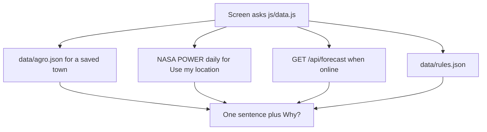

# Architecture

Walo is a phone-first static site plus a few serverless functions. There is no framework and no build step. The browser loads `app/index.html`, which pulls in `app/lib/agro.js` and the module `app/js/main.js`. Vercel’s project root must be `app`, so `/` is `app/index.html` and `/api/*` is `app/api/*`.

## Browser

`js/main.js` is the router. The route is `location.hash`.

| Hash | Screen module | Tab |
| --- | --- | --- |
| `#/welcome` | `js/screens/welcome.js` | — (first run only) |
| `#/` | `js/screens/home.js` | Home |
| `#/now` | `js/screens/now.js` | Home |
| `#/crop/<id>` | `js/screens/crop.js` | Home |
| `#/start[/<id>]` | `js/screens/start.js` | My farm |
| `#/farm[/<id>]` | `js/screens/farm.js` | My farm |
| `#/sell[/<crop>[/<field>]]` | `js/screens/sell.js` | Sell |
| `#/doctor[/<crop>[/<field>]]` | `js/screens/doctor.js` | Doctor |
| `#/help[/<from>]` | `js/screens/help.js` | Home |
| `#/backup` | `js/screens/backup.js` | My farm |
| `#/about` | `js/screens/about.js` | Home |

Shared modules:

| File | Role |
| --- | --- |
| `js/data.js` | Loads `data/*.json`, including `help.json` as `D.help`, and makes every decision the screens show. Uses `lib/agro.js` and `data/rules.json`. |
| `lib/agro.js` | FAO-56 evapotranspiration, effective rain, onset, EcoCrop suitability, growing degree days. The same file runs in `scripts/build_agro.js`. |
| `js/store.js` | Place, main crop, and fields in `localStorage`. Field photos in IndexedDB. |
| `js/ui.js` | Answer card, Why? sheet, Listen, buttons, rows. |
| `js/photo.js` | The only photo path. Two `<input type="file">` elements live in `index.html`. Screens open them with `<label for>`, not `input.click()`. |
| `js/net.js` | Online flag. A failed call to `/api/` or another origin marks the phone offline even if `navigator.onLine` is true. |
| `js/twi.js` | Dormant for the hackathon. `twiOn()` is true only when `data/app.json` → `languages.enabled` includes `"tw"`. It is `["en"]`, so the module forces English, clears `walo.lang` and the Twi phrase cache on load, and does not call Khaya. The EN/Twi chip, Twi crop names, Twi Listen, and Twi Talk are behind that same flag. |
| `js/sync.js` | Optional Supabase backup. Local data stays the copy the farmer sees. |
| `js/log.js` | Event name, sizes, and browser family. No photo, no words, no place. |
| `js/screens/words.js` | Plain-language sentences shared by Plant now, the crop page, and Why?. |
| `js/screens/pickers.js` | Place, crop, and main-crop sheets. |
| `js/tips.js` | Weather-timed actions for a planted field (fertiliser before rain, no spraying ahead of heavy rain, dry-spell watering, harvest window). Silent when there is no forecast. |
| `js/calendar.js` | The season as an `.ics` file: the crop's own stages and harvest, so the phone's calendar can ring offline. |
| `js/screens/welcome.js` | First run: two doors (I have a farm / I want to plant a crop) and the one question each needs. Shown only while no place has ever been chosen and no real field exists, so a returning farmer never sees it. |
| `sw.js` | Cache `walo-v33`. Code and JSON are network-first. Photos and the font are cache-first. `/api/` is never cached. Install caches each file on its own, so one missing file can no longer fail the whole install; failures are reported to `/api/log` as `sw_missing`. |

`data/app.json` holds settings that are not climate, crops, or prices: default place, endpoints, photo size, zone names, the empty support phone, and the Supabase publishable config.

`data/countries.json` holds everything that changes by country: accepted coordinates, currency, the onset search windows, zone names, the map, source labels, and a `status` gate (`live` or `draft`). `js/data.js` reads it on the phone; `api/_country.js` reads the same file on the server, so the AI routes accept exactly the countries the app offers. Adding a country is a data change plus a local review — see [EXPANSION.md](EXPANSION.md).

## What happens on a decision

Saved towns (17 of them, in `data/places.json`) use the precomputed NASA POWER summary in `data/agro.json`. “Use my location” fetches NASA POWER in the browser for that point and runs `lib/agro.js` on the phone. The 10-day forecast, when the Meteomatics names are set, can move “wait for the planting rain” to a weekday. If the forecast has no planting rain, the screen says to wait, so the climatology and the forecast do not contradict each other. Offline with no saved forecast, the answer uses the usual onset. If a forecast was saved earlier, Plant now says it is using that last forecast.

Sell reads `data/market.json`: a seasonal index (month price divided by that year’s average, averaged over 2015–2023) for the nearest of 20 WFP markets, plus MoFA SRID 2025 rows for Techiman. The advice for a field starts from that field’s harvest date.

Plant Doctor posts up to three photos and/or the farmer’s words to `/api/diagnose`. The function also fetches the last valid 14 days of NASA POWER for that point and passes them to Gemini as background. The phone shows the model’s JSON, labelled as an AI answer. Diagnose and Get help share `api/_gemini.js` for model choice and `api/_budget.js` for the daily cap on AI calls.

Get help (`#/help`) posts the last few messages and a short farm context (place, main crop, fields) to `/api/help`. The model is limited to the facts in `data/help.json`, which the browser already loaded. When the model is unsure, or the farmer asks for a person, the screen offers `tel:` and `wa.me` links built from `data/app.json` → `support.phone` and `support.whatsapp`. Both are empty, so the screen says a help line is coming soon. The server does not store the chat. WhatsApp text is filled in on the phone only.

## Server functions

All of these are Vercel Node functions. They read secrets from the environment and write no farmer photos or questions to a database.

| File | Method | Calls | Limit |
| --- | --- | --- | --- |
| `api/diagnose.js` | POST | Gemini, NASA POWER daily, the shared AI budget | 8 checks / 10 min / IP, plus the daily cap, 38 s model budget, phone gives up at 45 s |
| `api/forecast.js` | GET `lat`, `lon` | Meteomatics `precip_24h` and `t_max_2m_24h`, model mix | Response cached 3 hours. Ghana box only: lat −5..16, lon −10..6 |
| `api/help.js` | POST | Gemini, with `data/help.json` in the prompt, the shared AI budget | 20 / 10 min / IP, plus the daily cap |
| `api/twi.js` | GET `status`, `tts`; POST `translate`, `asr` | Returns **404** while `languages.enabled` does not include `"tw"`. When it is on: GhanaNLP Khaya translate v2 (`en-tw` / `tw-en`), TTS v1, ASR v3. `KHAYA_API_KEY` stays on the server. A 403 or 429 backs off. Nothing the farmer typed or said is logged. |
| `api/log.js` | POST | `console.log` of a whitelist of short fields | Body capped at 4 KB |
| `api/_gemini.js` | shared | Gemini model list and generateContent | Used by diagnose and help. Not a public route worth calling on its own. |
| `api/_budget.js` | shared | One rpc call to `public.walo_ai_hit()` in Supabase | The daily cap across all instances. The cap is a constant inside the SQL function, never an argument. Returns null when the SQL is not applied or Supabase does not answer; the caller then relies on the per-IP limits only. |
| `api/_country.js` | shared | `data/countries.json` | Accepted coordinates for forecast and diagnose, and the country name used in the AI prompts. Only countries with `status: "live"` count. |

`vercel.json` gives `diagnose` and `twi` 60 seconds, `help` 30 seconds, and `diagnose` 1024 MB. Forecast and log use the platform default. `/api/diagnose`, `/api/forecast`, `/api/log`, and `/api/help` are sent `Cache-Control: no-store`. Forecast sets its own short public cache when it has a fresh body.

## Storage

On the phone:

- `localStorage`: chosen place, main crop, field records, Twi preference.
- IndexedDB: field photos and Twi audio clips (`walo-tts`).
- A demo field (`data/app.json` → `demo_farm`, id `demo`) is seeded once and is never uploaded.

Optional backup, Supabase project `walo`, ref `yceufknddlcrezefaivi`:

- Client uses only `backup.url` and `backup.key` from `data/app.json`. The key is the publishable key.
- Table `public.fields`: `user_id` defaults to `auth.uid()`, `id` is the field uid, `data` jsonb, `deleted`, `updated_at`. Primary key `(user_id, id)`. RLS on. Policies are `auth.uid() = user_id`. No `anon` access.
- Private bucket `field-photos`, path `<user id>/<field uid>/<photo>.jpg`.
- The main-crop choice syncs as one settings row (`backup.settings_id`).
- Push is delayed 1.5 s. On sign-in, the phone pulls. If both sides changed, the newer `updated` wins. Sign-out leaves the fields on the phone.

## Offline

The live service worker cache is `walo-v26` (deployment `dpl_CHUzrfUQkVGaUMReutssEamCsPrJ`). After one successful visit it can show What to plant, crop pages, My farm, and Sell from the cache. `data/i18n-tw.json` is kept in the repo and is not in the precache while Twi is off. `js/net.js` sets `body.offline` from `navigator.onLine` and from a failed call to `/api/` or another origin. The top bar then shows a dark **Offline** chip. Controls with `data-net` (Plant Doctor, a fresh forecast, Talk, Get help, backup, Use my location) turn grey and carry a **Needs internet** tag; tapping one opens a sheet whose list is `data/app.json` → `offline.works`.

## What is not in the running app

`app/scripts/` builds the JSON. `app/.vercelignore` keeps that directory out of the deployment. Proof, the check-in deck, and `docs/` sit beside `app/` and are not on the Vercel root either.
