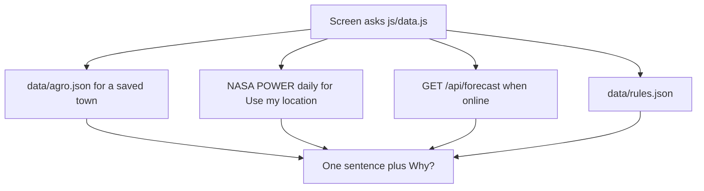

# Architecture

Walo is a phone-first static site plus a few serverless functions. There is no framework and no build step. The browser loads `app/index.html`, which pulls in `app/lib/agro.js` and the module `app/js/main.js`. Vercel’s project root must be `app`, so `/` is `app/index.html` and `/api/*` is `app/api/*`.

## Browser

`js/main.js` is the router. The route is `location.hash`.

| Hash | Screen module | Tab |
| --- | --- | --- |
| `#/` | `js/screens/home.js` | Home |
| `#/now` | `js/screens/now.js` | Home |
| `#/crop/<id>` | `js/screens/crop.js` | Home |
| `#/start[/<id>]` | `js/screens/start.js` | My farm |
| `#/farm[/<id>]` | `js/screens/farm.js` | My farm |
| `#/sell[/<crop>[/<field>]]` | `js/screens/sell.js` | Sell |
| `#/doctor[/<crop>[/<field>]]` | `js/screens/doctor.js` | Doctor |
| `#/help[/<from>]` | `js/screens/help.js` | Home |
| `#/backup` | `js/screens/backup.js` | My farm |
| `#/about` | `js/screens/about.js` | Home |

Shared modules:

| File | Role |
| --- | --- |
| `js/data.js` | Loads `data/*.json` and makes every decision the screens show. Uses `lib/agro.js` and `data/rules.json`. |
| `lib/agro.js` | FAO-56 evapotranspiration, effective rain, onset, EcoCrop suitability, growing degree days. The same file runs in `scripts/build_agro.js`. |
| `js/store.js` | Place, main crop, and fields in `localStorage`. Field photos in IndexedDB. |
| `js/ui.js` | Answer card, Why? sheet, Listen, buttons, rows. |
| `js/photo.js` | The only photo path. Two `<input type="file">` elements live in `index.html`. Screens open them with `<label for>`, not `input.click()`. |
| `js/net.js` | Online flag. A failed call to `/api/` or another origin marks the phone offline even if `navigator.onLine` is true. |
| `js/twi.js` | EN/Twi toggle, Khaya translation and voice through `/api/twi`, speech cache. |
| `js/sync.js` | Optional Supabase backup. Local data stays the copy the farmer sees. |
| `js/log.js` | Event name, sizes, and browser family. No photo, no words, no place. |
| `js/screens/words.js` | Plain-language sentences shared by Plant now, the crop page, and Why?. |
| `js/screens/pickers.js` | Place, crop, and main-crop sheets. |
| `sw.js` | Cache `walo-v21`. Code and JSON are network-first. Photos and the font are cache-first. `/api/` is never cached. |

`data/app.json` holds settings that are not climate, crops, or prices: default place, endpoints, photo size, zone names, the empty support phone, and the Supabase publishable config.

## What happens on a decision

Saved towns (17 of them, in `data/places.json`) use the precomputed NASA POWER summary in `data/agro.json`. “Use my location” fetches NASA POWER in the browser for that point and runs `lib/agro.js` on the phone. The 10-day forecast, when the Meteomatics names are set, can move “wait for the planting rain” to a weekday. If the forecast has no planting rain, the screen says to wait, so the climatology and the forecast do not contradict each other. Offline, the answer uses the usual onset and says so in Why?.

Sell reads `data/market.json`: a seasonal index (month price divided by that year’s average, averaged over 2015–2023) for the nearest of 20 WFP markets, plus MoFA SRID 2025 rows for Techiman. The advice for a field starts from that field’s harvest date.

Plant Doctor posts up to three photos and/or the farmer’s words to `/api/diagnose`. The function also fetches the last valid 14 days of NASA POWER for that point and passes them to Gemini as background. The phone shows the model’s JSON, labelled as an AI answer. Get help posts the last few messages and a short farm context to `/api/help`, which reads `data/help.json`.

## Server functions

All of these are Vercel Node functions. They read secrets from the environment and write no farmer photos or questions to a database.

| File | Method | Calls | Limit |
| --- | --- | --- | --- |
| `api/diagnose.js` | POST | Gemini, NASA POWER daily | 8 checks / 10 min / IP, 38 s model budget, phone gives up at 45 s |
| `api/forecast.js` | GET `lat`, `lon` | Meteomatics `precip_24h` and `t_max_2m_24h`, model mix | Response cached 3 hours. Ghana box only: lat −5..16, lon −10..6 |
| `api/help.js` | POST | Gemini, with `data/help.json` in the prompt | 20 / 10 min / IP |
| `api/twi.js` | GET and POST | GhanaNLP Khaya translate, TTS, ASR | Key stays on the server. Machine Twi. |
| `api/log.js` | POST | `console.log` of a whitelist of short fields | Body capped at 4 KB |
| `api/_gemini.js` | shared | Gemini model list and generateContent | Used by diagnose and help. Not a public route worth calling on its own. |

`vercel.json` gives `diagnose` and `twi` 60 seconds, `help` 30 seconds, and `diagnose` 1024 MB. Forecast and log use the platform default. `/api/diagnose`, `/api/forecast`, `/api/log`, and `/api/help` are sent `Cache-Control: no-store`. Forecast sets its own short public cache when it has a fresh body.

## Storage

On the phone:

- `localStorage`: chosen place, main crop, field records, Twi preference.
- IndexedDB: field photos and Twi audio clips (`walo-tts`).
- A demo field (`data/app.json` → `demo_farm`, id `demo`) is seeded once and is never uploaded.

Optional backup, Supabase project `walo`, ref `yceufknddlcrezefaivi`:

- Client uses only `backup.url` and `backup.key` from `data/app.json`. The key is the publishable key.
- Table `public.fields`: `user_id` defaults to `auth.uid()`, `id` is the field uid, `data` jsonb, `deleted`, `updated_at`. Primary key `(user_id, id)`. RLS on. Policies are `auth.uid() = user_id`. No `anon` access.
- Private bucket `field-photos`, path `<user id>/<field uid>/<photo>.jpg`.
- The main-crop choice syncs as one settings row (`backup.settings_id`).
- Push is delayed 1.5 s. On sign-in, the phone pulls. If both sides changed, the newer `updated` wins. Sign-out leaves the fields on the phone.

## Offline

After one successful visit, the service worker can show What to plant, crop pages, My farm, and Sell from the cache. `data/app.json` → `offline.works` is the sentence the offline sheet uses. Plant Doctor, the live forecast, Twi voice, Get help, and backup need a network. Those controls carry `data-net`. While `body` has the class `offline`, they are greyed and tagged “Needs internet”.

## What is not in the running app

`app/scripts/` builds the JSON. `app/.vercelignore` keeps that directory out of the deployment. Proof, the check-in deck, and `docs/` sit beside `app/` and are not on the Vercel root either.
