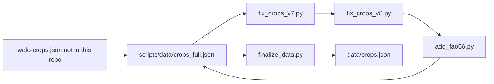

# Data pipeline

The phone reads the JSON in `app/data/`. The builders live in `app/scripts/` and are not deployed. Run them from `app/` so their relative paths resolve. They do not share a package manifest. Python scripts use the standard library. `build_agro.js` uses Node’s `fs` module only.

Do not hand-edit numbers in `data/crops.json`, `data/market.json`, `data/places.json`, `data/agro.json`, or `data/ndvi.json` to “fix” a screen. Change the builder or the threshold in `data/rules.json`, rebuild, and check the result against [proof/walo_proof.py](../proof/walo_proof.py) for a saved town.

## What each shipped file is

| File | How it is produced | Safe to rebuild from this repo alone? |
| --- | --- | --- |
| `data/app.json` | Written by hand. Endpoints, photo limits, zone names, backup, support phone. | Edit in place. It is not generated. |
| `data/rules.json` | Written by hand. Every threshold and its source, or `default: true`. | Edit in place, then rebuild `agro.json` if the onset or ET0 rules changed. |
| `data/help.json` | Written by hand. Facts the Get help model is allowed to use. | Edit in place. |
| `data/credits.json` | Photo credits. `build_crops.py` can append rows, but that script’s inputs are not in this repo. | Treat the shipped file as the source. |
| `data/ghana-map.json` | Ghana outline from Natural Earth. No builder in this repo. | Leave it. |
| `data/i18n-tw.json` | `scripts/build_i18n_tw.py` through `/api/twi`. `reviewed_by_twi_speaker` is false. | Only with a running Khaya proxy and a label list. A re-run still needs a Twi speaker. |
| `data/crops.json` | `scripts/finalize_data.py` from `scripts/data/crops_full.json`. | Yes, finalize can rewrite it from the committed full file. |
| `data/market.json` | `scripts/finalize_data.py` from `scripts/data/market_full.json`. | Yes, same. |
| `data/places.json` | `scripts/finalize_data.py` from `scripts/data/climate.json`, `locations.json`, `places_monthly.json`, and the zone map inside `crops_full.json`. | Yes, same. |
| `data/agro.json` | `scripts/fetch_agro.py` then `node scripts/build_agro.js`. | Yes, with a network. Overwrites the file. |
| `data/ndvi.json` | `scripts/build_ndvi.py`. | Yes, with a network. Overwrites the file. |
| `scripts/data/crops_full.json` | Historical chain below. This is the full crop record the app file is cut down from. | Do not regenerate here. The upstream knowledge base is not in the repo. |
| `scripts/data/market_full.json` | `scripts/build_markets.py`. | Needs the WFP CSV, which is not in the repo. |
| `scripts/data/climate.json`, `locations.json`, `places_monthly.json` | Earlier NASA POWER monthly pulls for Ejura, Techiman, Tamale, and the regional capitals. Inputs to `finalize_data.py`. | Leave them unless you are replacing coordinates on purpose. |

`app/README.md` lists a regenerate order that matched the machine where the files were first built. Several of those paths (`/workspace/walo-crops.json`, `/workspace/walo-app`, `/workspace/walo-crops-build/wfp_gha.csv`, `scripts/build_data.py`, `scripts/crops_v4_base.json`) are not in this repository. Use the commands below, not that list, when you are working from a fresh clone.

## Crop chain



`scripts/build_crops.py` was the step that created `crops_full.json` from the team knowledge base. It also expects `WALO_APP` (default `/workspace/walo-app`), a v4 base file, a photo-credit JSON, and `scripts/build_data.py`. None of those are here. The committed `scripts/data/crops_full.json` is the artifact to keep. The human-readable companion, with confidence and the source list, is [walo-crops-sources.md](walo-crops-sources.md). It still mentions `/workspace/walo-crops.json` because that was its path on the day it was generated (14 Nov 2026).

Later edits, all idempotent if their inputs exist:

1. `python3 scripts/fix_crops_v7.py` — sourced window and rainfall fixes. Reads and writes `scripts/data/crops_full.json` only.
2. `python3 scripts/fix_crops_v8.py` — Rain forest and Coastal savanna zones. Also opens `walo-crops.json` one directory above `app/` (the repository root). That file is not here, so this script cannot be re-run from a clone.
3. `python3 scripts/add_fao56.py` — writes `fao56` crop coefficients and stage lengths, transcribed from [FAO-56 Table 11 and Table 12](https://www.fao.org/4/x0490e/x0490e0b.htm), onto `crops_full.json`.
4. `python3 scripts/finalize_data.py` — writes `data/crops.json` with only the keys the app reads.

Shea is excluded in the crop build (wild parkland tree). Nineteen crops ship. Cocoa and cashew are marked as trees and are not tracked as seasonal fields.

## Places, climate, greenness

`data/places.json` has 17 towns. Ejura, Techiman, and Tamale come from the team’s NASA POWER requests (`scripts/data/climate.json`, `scripts/data/locations.json`). The other regional capitals come from `scripts/data/places_monthly.json` (coordinates cited there as Wikipedia / Wikidata). Zones are FAO’s Ghana zones: Rain forest `F`, Transitional `T`, Guinea savanna `G`, Coastal savanna `C`.

Rebuild the daily climate summary:

```bash
cd app
python3 scripts/fetch_agro.py          # NASA POWER daily 1991–2025 → /tmp/agro/<place>.json
node scripts/build_agro.js             # /tmp/agro + lib/agro.js + data/rules.json → data/agro.json
```

`fetch_agro.py` asks for `PRECTOTCORR`, `T2M`, `T2M_MAX`, `T2M_MIN`, `RH2M`, `WS2M`, `ALLSKY_SFC_SW_DWN`, community `AG`, 1 Jan 1991 through 31 Dec 2025. Cached files under `/tmp/agro` are not committed. `build_agro.js` summarizes every `*.json` in that directory. Fetch all 17 towns before building, or a town with no cache file disappears from `agro.json`.

Greenness:

```bash
cd app
python3 scripts/build_ndvi.py
```

That script reads coordinates from `data/agro.json`, searches the Planetary Computer STAC collection `modis-13Q1-061` (Terra, 2016 through 2026), and takes the median NDVI in a box about 3 km by 3 km (`HALF = 0.0135` degrees). Monthly values are the mean of composites that start in that month, years 2016–2025. No API key. It overwrites `data/ndvi.json` and stamps today’s date.

## Prices

```bash
cd app
WALO_WFP_CSV=/path/to/wfp_food_prices_gha.csv python3 scripts/build_markets.py
python3 scripts/finalize_data.py
```

`build_markets.py` defaults `WALO_WFP_CSV` to `/workspace/walo-crops-build/wfp_gha.csv`, which is not in this repo. The HDX file is [WFP food prices for Ghana](https://data.humdata.org/dataset/wfp-food-prices-for-ghana). The script:

- keeps markets with at least 100 rows, and series with at least 12 kept observations
- builds a seasonal index for 2015–2023
- drops an observation above 3× the median of its neighbours (6 before and 6 after, at least 4 neighbours) from the index, and lists it under `excluded`
- keeps MoFA SRID 2025 and other quoted rows already present in `scripts/data/market_full.json`

`finalize_data.py` copies, for each crop, the series flagged `main`, the index rounded to 3 decimals, and `srid2025`. The shipped `data/market.json` notes say WFP/HDX observations end in July 2023, 20 markets are kept, and 782 outlier rows were excluded. Groundnut has no HDX series; its prices are the SRID 2025 Techiman rows only.

## Twi labels

```bash
cd app
python3 scripts/build_i18n_tw.py labels.json http://127.0.0.1:8813/api/twi
```

The label list is a JSON array of English strings. Strings already in `data/i18n-tw.json` are kept. Town names and a short allow-list (Walo, NASA POWER, and similar) stay in English. The script talks to our `/api/twi` proxy, not to Khaya directly, so the key stays on that server. Output is machine translation. The file’s `reviewed_by_twi_speaker` flag stays false until a person changes it.

## Order that preserves the shipped app files

From a clone, with no extra inputs, the only rebuild that does not need a network or a missing file is:

```bash
cd app
python3 scripts/finalize_data.py
```

That rewrites `data/crops.json`, `data/market.json`, and `data/places.json` from `scripts/data/*`. Run it only when you have changed those full files. Compare the diff before you commit. A network rebuild of `agro.json` or `ndvi.json` will also change `fetched` dates and can move a percentile by a day if NASA revises a recent value. Check Ejura maize onset against [docs/METHODS.md](METHODS.md) before replacing `agro.json`.
